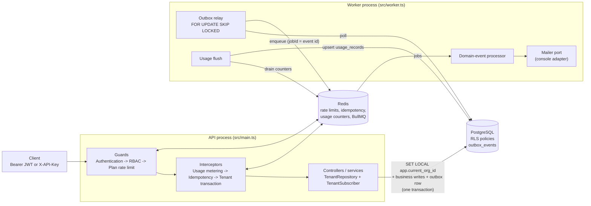

# nest-saas-kit

[](https://github.com/RatulSikder97/nest-saas-kit/actions/workflows/ci.yml)


A production-grade **multi-tenant SaaS backend starter** built on NestJS 11, TypeORM, PostgreSQL and Redis.

Most starters stop at "JWT + CRUD". This one covers the parts that usually get bolted on later:

- **Tenant isolation enforced twice.** An application-layer guard (repository + TypeORM subscriber) and **Postgres Row-Level Security** underneath. If a query forgets its tenant filter, it returns nothing instead of leaking data.
- **Session security that holds up in review.** argon2id passwords, short-lived JWTs, **rotating refresh tokens with reuse detection** (replaying a rotated token revokes the whole session family), hashed and prefix-identifiable API keys.
- **SaaS plumbing.** Organizations, invitations, RBAC (owner / admin / member), per-plan rate limits, usage metering, audit log with JSON diffs, `Idempotency-Key` support, and a transactional outbox feeding BullMQ workers.
- **Operational basics.** zod-validated config, structured pino logs with request ids, health probes, OpenAPI, graceful shutdown, real migrations (never `synchronize`), multi-stage Docker image, CI with service containers.

Stack: Node 22, pnpm, strict TypeScript, NestJS 11, TypeORM 0.3, PostgreSQL 17, Redis 7, BullMQ 5, Jest + Supertest.

---

## Architecture



### Request lifecycle

1. **`AuthenticationGuard`** resolves a `Principal` from a Bearer JWT or an `X-API-Key`. The principal carries the tenant (`organizationId`), role and plan.
2. **`RolesGuard`** enforces `@MinRole()` and `@UserOnly()`.
3. **`ThrottlerGuard`** applies the plan's limit to a per-organization bucket in Redis.
4. **`UsageMeteringInterceptor`** increments a Redis counter for the organization.
5. **`IdempotencyInterceptor`** replays cached responses for repeated `Idempotency-Key`s.
6. **`TenantTransactionInterceptor`** opens a transaction and runs `set_config('app.current_org_id', ..., true)`, so every query in the request runs under RLS for that tenant.
7. Services use `TenancyService.repository(Entity)`, which scopes every read and stamps every write.

---

## Quickstart

Requirements: Node 22+, pnpm 10 (`corepack enable`), Docker.

```bash
git clone https://github.com/RatulSikder97/nest-saas-kit.git
cd nest-saas-kit
cp .env.example .env

docker compose up -d postgres redis   # Postgres 17 on :5432, Redis 7 on :6379
pnpm install
pnpm db:migrate                       # applies migrations, creates the RLS-bound runtime role
pnpm db:seed                          # demo owner, organization, project and API key (printed)

pnpm dev                              # API on http://localhost:3000, Swagger UI at /docs
pnpm dev:worker                       # second terminal: outbox relay, emails, usage flush
```

If ports 5432 or 6379 are already taken, set `POSTGRES_PORT` / `REDIS_PORT` for compose and update the URLs in `.env` to match.

### Everything in Docker

```bash
docker compose --profile app up --build
```

This runs `migrate` (one-shot) and then starts `api` and `worker` from the same multi-stage image. Change `JWT_ACCESS_SECRET`, `API_KEY_PEPPER` and `APP_DB_PASSWORD` for anything beyond local use.

### Scripts

| Command                                                  | What it does                                                                                 |
| -------------------------------------------------------- | -------------------------------------------------------------------------------------------- |
| `pnpm dev` / `pnpm dev:worker`                           | API / worker in watch mode                                                                   |
| `pnpm build`                                             | Compile to `dist/`                                                                           |
| `pnpm start` / `pnpm start:worker`                       | Run the compiled API / worker                                                                |
| `pnpm db:migrate` / `pnpm db:revert`                     | Apply all migrations / revert the last one                                                   |
| `pnpm db:migrate:prod`                                   | Run migrations from `dist/` (used by the Docker `migrate` service)                           |
| `pnpm db:seed`                                           | Idempotent demo data                                                                         |
| `pnpm migration:generate src/database/migrations/<Name>` | Diff entities against the DB (then register the class in `src/database/migrations/index.ts`) |
| `pnpm lint` / `pnpm typecheck` / `pnpm format:check`     | Static checks                                                                                |
| `pnpm test` / `pnpm test:cov`                            | Unit tests                                                                                   |
| `pnpm test:e2e`                                          | E2E tests against real Postgres + Redis                                                      |

---

## Module map

| Path                        | Responsibility                                                                                                                                         |
| --------------------------- | ------------------------------------------------------------------------------------------------------------------------------------------------------ |
| `src/config`                | zod schema for every env var; boot fails fast on invalid config. Typed `AppConfig` facade.                                                             |
| `src/logging`               | nestjs-pino: JSON logs, `X-Request-Id` propagation, credential redaction.                                                                              |
| `src/database`              | DataSource options, ordered migration registry, `migrate` and `seed` CLIs.                                                                             |
| `src/tenancy`               | `TenancyService.run()` (transaction + RLS session vars via AsyncLocalStorage), `TenantRepository`, `TenantSubscriber`, `TenantTransactionInterceptor`. |
| `src/common`                | Principal types, role hierarchy, `@Public` / `@MinRole` / `@UserOnly` decorators, guards, DB exception filter, crypto + JSON-diff utilities.           |
| `src/modules/auth`          | Signup, login, refresh rotation with reuse detection, logout, organization switch, invitation acceptance.                                              |
| `src/modules/organizations` | Organizations, memberships, role changes, member removal (revokes that member's sessions).                                                             |
| `src/modules/invitations`   | Email invitations. The raw token exists only in the outbox payload and the email.                                                                      |
| `src/modules/api-keys`      | `nsk_<prefix>_<secret>` keys, HMAC-SHA256 at rest, role-capped, revocable.                                                                             |
| `src/modules/projects`      | Example tenant-owned resource used to demonstrate isolation.                                                                                           |
| `src/modules/audit`         | Append-only audit log (actor, action, entity, field-level JSON diff, request id), written in the same transaction as the change.                       |
| `src/modules/usage`         | Redis hot-path metering, exactly-once flush to `usage_records`, `GET /v1/usage`.                                                                       |
| `src/modules/rate-limit`    | `@nestjs/throttler` with Redis storage; limit chosen by plan, bucket per organization.                                                                 |
| `src/modules/idempotency`   | `Idempotency-Key` handling for POST requests.                                                                                                          |
| `src/modules/outbox`        | Outbox writer, relay (Postgres -> BullMQ), domain-event processor.                                                                                     |
| `src/modules/mailer`        | `Mailer` port with a console adapter; add SES/Postmark/SMTP adapters behind the same token.                                                            |
| `src/modules/health`        | Terminus `/health/live` and `/health/ready` (Postgres + Redis).                                                                                        |
| `src/worker`                | Worker module and BullMQ job schedulers (outbox relay, usage flush).                                                                                   |

---

## Security design

### Tenant isolation: two independent layers

**Application layer**

- Every request with a principal runs inside `TenancyService.run({ organizationId, userId })`. The scope lives in `AsyncLocalStorage`, so services never thread a tenant id through calls.
- `TenantRepository` adds `organizationId = <current>` to every read and overrides any value the caller supplied. It refuses to save or remove an entity owned by another organization.
- `TenantSubscriber` (a TypeORM entity subscriber) stamps inserts with the current organization and rejects inserts, updates and removes that target another tenant, even when they go through a raw `EntityManager`.

**Database layer (Postgres RLS)**

- The API and worker connect as `saas_app_user`, a member of the `saas_app` group role. It is created `NOSUPERUSER NOBYPASSRLS` and does not own any table, so RLS policies always apply to it. Migrations run as a separate owner role (`DATABASE_MIGRATION_URL`).
- `TenancyService.run()` starts a transaction and calls `set_config('app.current_org_id', $1, true)` (and `app.current_user_id`). These settings are **transaction-local**, so a pooled connection never carries a tenant into the next request.
- Policies on `projects`, `api_keys`, `invitations`, `audit_logs` and `usage_records` are `USING / WITH CHECK (organization_id = app_current_org_id())`. With no context set, `app_current_org_id()` is `NULL` and the policy is false: **queries fail closed.**
- `memberships` and `organizations` also let a user see their own memberships across organizations (needed to choose an organization at login). Writes are still limited to the current organization.
- Lookups that must happen before a tenant is known (resolving an API key by prefix, an invitation by token hash) go through two narrow `SECURITY DEFINER` functions instead of loosening the table policies.
- `users`, `refresh_tokens` and `outbox_events` are deliberately not tenant-scoped: identities span organizations, and the outbox is drained by a single relay. Only the app layer reads these tables, always by primary key or user id.

The e2e suite checks both layers separately. Over HTTP, org B gets 404 for org A's resources, on both JWT and API-key paths. With raw SQL through the runtime role, cross-tenant `SELECT` / `UPDATE` / `DELETE` affect zero rows, a cross-tenant `INSERT` fails with `42501`, and queries without a context see nothing.

### Tokens and credentials

| Credential    | Format                                  | Stored as                        | Notes                                                                                           |
| ------------- | --------------------------------------- | -------------------------------- | ----------------------------------------------------------------------------------------------- |
| Password      | user input (12-128 chars)               | argon2id (19 MiB, t=2, p=1)      | Unknown emails still run a dummy verify, so timing does not reveal which accounts exist.        |
| Access token  | HS256 JWT, 15 min                       | not stored                       | Claims: `sub`, `org`, `role`, `plan`, `sid` (session family), `typ`, `iss`.                     |
| Refresh token | `<uuid>.<43-char base62>`               | SHA-256 of the secret            | Single use, rotated on every refresh. Absolute lifetime is not extended by rotation.            |
| API key       | `nsk_<12-char prefix>_<40-char secret>` | HMAC-SHA256 with a server pepper | The prefix is stored in clear for O(1) lookup and log identification. The secret is shown once. |
| Invitation    | 43-char base62                          | SHA-256                          | Single use, expires (72 h by default), bound to the invited email.                              |

**Refresh-token rotation with reuse detection.** Every login starts a token _family_. Each refresh marks the presented token used, using an atomic compare-and-set `UPDATE ... WHERE used_at IS NULL AND revoked_at IS NULL`, and issues a successor in the same family. Presenting a token that was already used or revoked means it was replayed by someone other than the legitimate client, so **the entire family is revoked** and the user must sign in again. Two concurrent refreshes with the same token produce one success and one revocation, which the e2e suite asserts.

Each refresh re-reads role and plan from the database, so demotions and plan changes take effect within one access-token lifetime. Removing a member revokes their sessions for that organization.

**RBAC.** The roles form a hierarchy: `owner > admin > member`. `@MinRole('admin')` grants access to that role and every role above it. API keys carry `admin` or `member`, capped at the creator's role. `@UserOnly()` keeps API keys away from session and credential management (API keys, invitations, role changes), so a leaked key cannot mint more keys.

### Abuse controls

- **Rate limiting**: one fixed window per organization, shared across all of that organization's credentials and routes. Limits come from the plan (`RATE_LIMIT_FREE` / `PRO` / `ENTERPRISE`). Anonymous traffic is limited per IP. Counters live in Redis, so limits hold across replicas. Set `TRUST_PROXY=true` behind a load balancer so client IPs are correct.
- **Idempotency**: `POST` requests can send `Idempotency-Key`. Keys are scoped per principal and fingerprinted on method, path and body. The first response is cached for 24 h. A retry with the same key and same body replays the cached response (`Idempotent-Replayed: true`). A different body returns `422`, a request still in flight returns `409`, and failures release the key so the client can retry. This is implemented as an interceptor rather than raw Express middleware, because it needs the authenticated principal and the handler's result. It runs outside the tenant transaction, so only committed results are cached.

---

## Reliability patterns

- **Transactional outbox.** A domain event (for example `invitation.created`) is inserted into `outbox_events` in the same transaction as the state change. The worker relays committed rows to BullMQ using `FOR UPDATE SKIP LOCKED`, so replicas can relay concurrently, and uses the event id as the BullMQ `jobId`, so a crash between enqueue and commit cannot create a duplicate. Delivery is at-least-once, with exponential-backoff retries, and handlers must be idempotent.
- **Usage metering.** The request path does one Redis `HINCRBY`. The flush job atomically `RENAME`s each live hash to a uniquely named batch, then inserts the batch id into `usage_flush_batches` and upserts the counters in the same transaction. A crash after commit cannot double count. Metering is best effort: a Redis error is logged and does not fail the customer's request.
- **Job scheduling.** BullMQ job schedulers make each periodic tick run once across all worker replicas.
- **Graceful shutdown.** On `SIGTERM`, `/health/ready` begins failing and Terminus waits 5 s for load balancers to drain. Then the HTTP server, BullMQ workers (which finish in-flight jobs), the database pool and Redis close in order. Docker uses exec-form `CMD`, so the signal reaches Node.

---

## API examples

All application routes are under `/v1`. The OpenAPI document is served at `/docs` (UI) and `/docs/openapi.json`.

```bash
API=http://localhost:3000/v1

# Sign up: creates a user, an organization (you are owner) and a session
curl -s -X POST $API/auth/signup -H 'content-type: application/json' \
  -d '{"email":"ada@example.com","password":"correct-horse-battery","name":"Ada","organizationName":"Acme"}'
# -> { "tokenType":"Bearer", "accessToken":"...", "expiresIn":900, "refreshToken":"<id>.<secret>", "organizationId":"..." }

TOKEN=<accessToken>

# Create a project, safely retryable
curl -s -X POST $API/projects -H "authorization: Bearer $TOKEN" \
  -H 'content-type: application/json' -H 'Idempotency-Key: 6f1c-create-apollo' \
  -d '{"name":"Apollo"}'

# Create an API key (the secret is returned once) and use it
curl -s -X POST $API/api-keys -H "authorization: Bearer $TOKEN" \
  -H 'content-type: application/json' -d '{"name":"ci","role":"member"}'
curl -s $API/projects -H 'x-api-key: nsk_XXXXXXXXXXXX_...'

# Invite a teammate: the worker logs the email, including the accept link
curl -s -X POST $API/invitations -H "authorization: Bearer $TOKEN" \
  -H 'content-type: application/json' -d '{"email":"bob@example.com","role":"member"}'

# The invitee signs up with the token from the email and joins Acme
curl -s -X POST $API/auth/signup -H 'content-type: application/json' \
  -d '{"email":"bob@example.com","password":"another-long-password","name":"Bob","invitationToken":"<token>"}'

# Rotate the refresh token (the old one becomes unusable; replaying it revokes the session)
curl -s -X POST $API/auth/refresh -H 'content-type: application/json' -d '{"refreshToken":"<id>.<secret>"}'

# Audit trail (admin+) and usage
curl -s "$API/audit-logs?limit=5" -H "authorization: Bearer $TOKEN"
curl -s "$API/usage?from=2026-01-01" -H "authorization: Bearer $TOKEN"
```

### Endpoints

| Method & path                                              | Auth      | Min role       | Description                                                  |
| ---------------------------------------------------------- | --------- | -------------- | ------------------------------------------------------------ |
| `POST /v1/auth/signup`                                     | public    | -              | Create account + organization, or join via `invitationToken` |
| `POST /v1/auth/login`                                      | public    | -              | Optional `organizationId`; defaults to the oldest membership |
| `POST /v1/auth/refresh`                                    | public    | -              | Rotate the refresh token                                     |
| `POST /v1/auth/logout`                                     | public    | -              | Revoke the session family                                    |
| `POST /v1/auth/switch-organization`                        | user      | member         | New session scoped to another organization you belong to     |
| `POST /v1/auth/accept-invitation`                          | user      | member         | Existing user accepts an invitation                          |
| `GET /v1/auth/me`                                          | user      | member         | Current identity and tenant                                  |
| `GET /v1/organizations`                                    | user      | member         | Organizations you belong to                                  |
| `GET / PATCH /v1/organizations/current`                    | user, key | member / admin | Read / rename the current organization                       |
| `GET /v1/organizations/current/members`                    | user, key | member         | List members                                                 |
| `PATCH /v1/organizations/current/members/:userId`          | user      | owner          | Change a member's role                                       |
| `DELETE /v1/organizations/current/members/:userId`         | user      | admin          | Remove a member and revoke their sessions                    |
| `POST / GET /v1/invitations`, `DELETE /v1/invitations/:id` | user      | admin          | Manage invitations                                           |
| `POST / GET /v1/api-keys`, `DELETE /v1/api-keys/:id`       | user      | admin          | Manage API keys                                              |
| `GET / POST /v1/projects`, `GET / PATCH /v1/projects/:id`  | user, key | member         | Example tenant resource                                      |
| `DELETE /v1/projects/:id`                                  | user, key | admin          |                                                              |
| `GET /v1/audit-logs`                                       | user, key | admin          | Paginated, filterable by `entityType` / `entityId`           |
| `GET /v1/usage`                                            | user, key | member         | Flushed daily counters plus counters still pending in Redis  |
| `GET /health/live`, `GET /health/ready`                    | public    | -              | Liveness / readiness                                         |

Errors use Nest's standard shape (`{ statusCode, message, error }`). Unique violations map to `409`. A blocked cross-tenant write maps to `404` (app layer) or `403` (RLS).

---

## Testing

```bash
pnpm test        # unit: guards, token rotation, API-key auth, tenant repository/subscriber, idempotency, rate-limit policy
docker compose up -d postgres redis
pnpm test:e2e    # e2e: real Postgres + Redis, in-process API and worker
```

The e2e suite recreates a dedicated `saas_test` database from migrations and uses Redis DB 1, so it never touches development data. If you moved the compose ports, run it as `POSTGRES_PORT=... REDIS_PORT=... pnpm test:e2e`. It covers:

- **Tenant isolation** over HTTP (JWT and API key) and directly against RLS (role is not privileged; cross-tenant read, update, delete and insert are blocked; no context returns no rows; the ORM subscriber blocks cross-tenant writes).
- **Refresh tokens**: rotation, reuse detection revoking the family, a concurrent-refresh race, logout, and revocation on member removal.
- **RBAC** for user and API-key principals, and API-key revocation.
- **Rate limiting**: the plan limit is enforced per organization across credentials and does not affect other tenants.
- **Idempotency**: replay, payload mismatch, per-principal scoping, and failure release.
- **Outbox -> BullMQ -> mailer**: invitation email delivery, signup via invitation, acceptance by an existing user, and organization switching.
- **Usage metering**: Redis counters flushed to Postgres without double counting.

CI (`.github/workflows/ci.yml`) runs format, lint, typecheck and build, unit tests with coverage, e2e tests against Postgres 17 and Redis 7 service containers, and a Docker image build.

---

## Configuration

All variables are validated at startup by `src/config/env.schema.ts`. See [`.env.example`](.env.example) for the full list with defaults. The most important ones:

| Variable                              | Purpose                                                                                        |
| ------------------------------------- | ---------------------------------------------------------------------------------------------- |
| `DATABASE_URL`                        | Runtime connection. **Must use a dedicated non-owner role.** `db:migrate` creates or syncs it. |
| `DATABASE_MIGRATION_URL`              | Schema-owner connection, used only by migrations.                                              |
| `REDIS_URL`                           | Rate limits, idempotency, metering, BullMQ.                                                    |
| `JWT_ACCESS_SECRET`, `API_KEY_PEPPER` | At least 32 chars each. Rotate independently.                                                  |
| `RATE_LIMIT_*`                        | Requests per `RATE_LIMIT_WINDOW_SECONDS`, per plan and for anonymous callers.                  |
| `PUBLIC_APP_URL`                      | Base URL for links in invitation emails.                                                       |
| `TRUST_PROXY`                         | Set `true` behind a reverse proxy so client IPs are correct.                                   |

---

## Extending

- **New tenant-owned entity**: extend `TenantScopedEntity`, add it to `src/database/entities.ts`, and write a migration that creates the table, `GRANT`s it to `saas_app`, and adds the `tenant_isolation` policy (copy from `1732406500000-RowLevelSecurity.ts`). Then use `tenancy.repository(Entity)` in the service.
- **New domain event**: add a name to `DomainEvents`, call `outbox.enqueue()` inside the business transaction, and handle it in `DomainEventsProcessor`.
- **Real email**: implement `Mailer`, add a driver to `MAILER_DRIVER` in the env schema, and wire it in `MailerModule`.
- **Billing**: `organizations.plan` already drives rate limits and is re-read on refresh. Have a billing webhook update it.

## License

[MIT](LICENSE)
